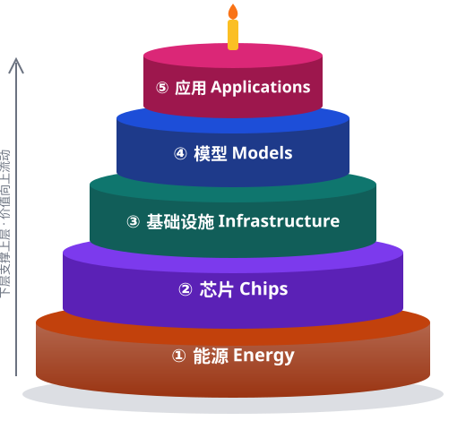

# 🍰 AI 五层蛋糕观察 · AI Five-Layer Cake Watch

以 NVIDIA 提出的 [AI 五层蛋糕](https://blogs.nvidia.cn/blog/ai-5-layer-cake/)为框架（**能源 → 芯片 → 基础设施 → 模型 → 应用**），按国家整理 AI 产业数据的静态网站，中英双语。纯 HTML/CSS/JS，无需构建，可直接用 GitHub Pages 托管。

A bilingual (Chinese / English) static site tracking AI's five-layer cake — **energy → chips → infrastructure → models → applications** — country by country.

🌐 网站 / Site: https://haoran-f-frank.github.io/ai-five-layer-cake/ （上传并开启 Pages 后生效 / live once uploaded and Pages is enabled）



## 目录结构

```
index.html                 主页：① 五层蛋糕讲解 ② 国家列表 ③ Reference
assets/
  style.css                样式（自动适配深色模式）
  five-layer-cake.svg      五层蛋糕讲解图
  i18n.js                  中 / 英语言切换
  countries.js             国家列表 + 站点更新日期
  refs.js                  ★ 全站参考文献库（REFS；英文标题在 REFS_EN）
  cite.js                  引用编号与 Reference 列表生成
  country.js               国家页渲染器（表格、地图、引用）
countries/
  china/  index.html + data.js（中文）+ data.en.js（英文）   ★ 中国（中国大陆）
  usa/    index.html + data.js（中文）+ data.en.js（英文）   ★ 美国
  korea/ japan/ singapore/ canada/ australia/ uk/ france/ germany/ switzerland/   （规划中）
  _template/               新增国家时复制这个文件夹
  */README.md, README.en.md, plants.geojson   ← 自动生成的 GitHub 仓库内查看版（见下）
scripts/
  build_github_views.py    生成上面三个文件
.github/workflows/
  build-github-views.yml   数据变动后自动运行上面的脚本
```

## 两种查看方式

| | 交互网站（GitHub Pages） | 仓库内直接查看 |
|---|---|---|
| 地址 | https://haoran-f-frank.github.io/ai-five-layer-cake/ | [countries/china](countries/china) 等文件夹 |
| 内容 | 完整网页：地图、可展开分类、中英切换 | 自动生成的 `README.md`（中文）/ `README.en.md`（英文）表格 + Reference，以及 GitHub 可交互的电厂地图 `plants.geojson` |

国家文件夹里的 `README.md`、`README.en.md`、`plants.geojson` 是由 `data.js`、`data.en.js` 和 `refs.js` **自动生成**的，不要手动改：
- 在 GitHub 网页上改数据并 Commit 后，GitHub Actions（`.github/workflows/build-github-views.yml`）会在约 1 分钟内自动重新生成并提交。
- 在本地改数据的话，也可以自己运行：`python scripts/build_github_views.py`。
- 第一次使用前要确认：仓库 **Settings → Actions → General → Workflow permissions** 选 **Read and write permissions**，否则自动提交会失败。

## 双语模式

- 每页右上角有 **English / 中文** 按钮；也可以在网址后加 `?lang=en` 或 `?lang=zh` 直接打开某个语言（方便分享英文链接）。
- 网站会记住访客上次选择的语言；第一次访问时按浏览器语言自动选择。
- 主页文字直接写在 `index.html` 里（`<span lang="zh">` 和 `<span lang="en">` 成对出现）。
- 国家数据分两个文件：`data.js`（中文）和 `data.en.js`（英文），**数字和 refs 要保持一致**。英文文件缺失时自动显示中文数据。
- 参考文献共用一份：`refs.js` 里的 `REFS_EN` 给中文来源配英文标题，链接不变。

## 每个国家包含的内容

1. **Energy 能源供给**：1.1 火电（煤 / 油 / 气）、1.2 水电、1.3 核电、1.4 风电、1.5 太阳能、1.6 生物质、1.7 地热、1.8 潮汐、1.9 其他。每类含发电原理、全国数量、装机、发电量、材料消耗、运维人员、地图标注，并把电厂分为 **国有 Public / 私有 Private（标明企业）** 两张表。
2. **Chips 芯片**：Design（主流 GPU / CPU 对比）、Produce（原料、产地、晶圆厂）、Purchase（进出口额与类型）。
3. **Infrastructure 基础设施**：大公司数据中心数量；Energy-transmit 电网（建设时间、运维人员、最高负荷）。
4. **Models 模型**：主流模型的参数、架构、开放情况与代表性成绩。
5. **Applications 应用**：AI4Science、自动驾驶、具身智能等主题梳理。

## 引用规则（每条数据都要有来源）

- 所有来源统一登记在 `assets/refs.js`：`"id": { title, publisher, url }`；中文来源可在 `REFS_EN` 里加英文标题。
- 数据里用 `refs: ["id1", "id2"]` 引用，页面会自动显示 `[1][2]` 上标，并在页面底部生成 **Reference** 列表（按首次出现顺序编号）。
- 引用了 `refs.js` 里不存在的 id 时，页面显示 `[?]`，浏览器控制台会给出警告。

### 数据与估算说明

- 数值优先采用政府统计（国家能源局、中电联、国家统计局、海关总署、U.S. EIA 等）和企业官方披露。
- 无统一官方统计的项目（单个电厂的运维人数、燃料消耗等）按行业典型值估算，引用 `est-note` 并注明“估算”。
- “≈” 表示约数。**初版数据由 AI 辅助整理，发布前和日常更新时请对照原始来源核实。**

## 本地预览

直接双击 `index.html` 即可打开。如果想模拟线上环境：

```bash
python -m http.server 8000
```

然后访问 http://localhost:8000 。

## 上传到 GitHub 并发布为网站（GitHub Pages）

账号：[Haoran-F-Frank](https://github.com/Haoran-F-Frank)，建议仓库名 `ai-five-layer-cake`（换名字的话，网址最后一段也跟着变）。

**方法 A：网页上传（不用安装任何软件）**

1. 打开 https://github.com/new ，Repository name 填 `ai-five-layer-cake`，选 **Public**，点 **Create repository**。
2. 在新仓库页面点 **uploading an existing file**，把本项目的所有文件和文件夹拖进去 → **Commit changes**。
   （`.nojekyll` 和 `.github` 以点开头；拖拽后请确认 `.github/workflows/build-github-views.yml` 已出现在仓库里。没有的话：仓库页面 **Add file → Create new file**，文件名填 `.github/workflows/build-github-views.yml`，把本地同名文件内容粘贴进去再 Commit。`.nojekyll` 缺失不影响使用。）
3. 打开 https://github.com/Haoran-F-Frank/ai-five-layer-cake/settings/pages ：Source 选 **Deploy from a branch**，Branch 选 `main`、文件夹 `/ (root)` → **Save**。
4. 约 1 分钟后访问：https://haoran-f-frank.github.io/ai-five-layer-cake/

**方法 B：用 Git 命令行**（需先安装 [Git for Windows](https://git-scm.com/download/win)，首次推送时会弹出浏览器让你登录 GitHub）

```bash
git init
git add .
git commit -m "Initial site"
git branch -M main
git remote add origin https://github.com/Haoran-F-Frank/ai-five-layer-cake.git
git push -u origin main
```

然后同样在 Settings → Pages 里开启。

## 每日更新流程

1. 编辑对应国家的 `countries/<国家>/data.js`，并同步修改 `data.en.js`（GitHub 网页上点文件 → 铅笔图标即可在线编辑）。
2. 新来源先加到 `assets/refs.js`（中文来源再在 `REFS_EN` 里加英文标题），然后在数据里引用。
3. 修改两个数据文件的 `updated` 和 `assets/countries.js` 的 `SITE_UPDATED` 日期。
4. Commit 后 GitHub Pages 网站会在 1 分钟左右自动更新，国家文件夹里的 README / 地图也会由 GitHub Actions 自动重新生成。

## 新增国家

1. 复制 `countries/_template` 为 `countries/<新国家>`（列表中的 10 个国家已建好文件夹）。
2. 参考 `countries/china/data.js` 和 `data.en.js` 填写中英文数据，把两个文件里的 `status` 都改为 `"active"`。
3. 在 `assets/countries.js` 中把该国 `status` 改为 `"active"`。
4. 生成脚本会自动处理新国家的 `README.md` / `README.en.md` / `plants.geojson`。
